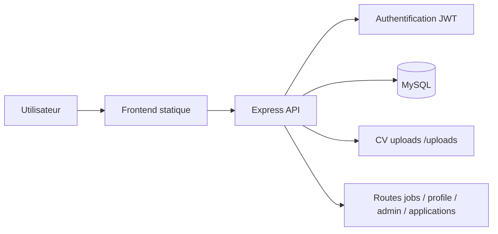

# RECRUTDNCS - Architecture du projet et hébergement gratuit

## 1. Vue d’ensemble

RECRUTDNCS est une plateforme de gestion de recrutement développée en Node.js avec Express et une base de données MySQL. Elle permet :

- l’inscription et la connexion des utilisateurs,
- la gestion des profils,
- la publication et la gestion des offres d’emploi,
- la gestion des candidatures,
- les rôles candidat, recruteur et administrateur,
- le dépôt de CV en PDF.

Le projet est structuré autour d’une API backend et d’un frontend statique servi par le même serveur Express.

---

## 2. Architecture technique

### Backend
- Langage : JavaScript / Node.js
- Framework : Express.js
- Sécurité : Helmet, CORS, JWT, bcrypt, Joi
- Upload : Multer
- API REST : routes exposées sous `/api`

### Base de données
- SGBD : MySQL
- Configuration dans : [src/config/database.js](src/config/database.js)
- Fichier de création : [database.sql](database.sql)

### Frontend
- HTML, CSS, JavaScript statiques
- Servis depuis le dossier [public](public)
- Exemples de pages : login, register, dashboard, admin, jobs

### Fichiers uploadés
- Dossier : [uploads](uploads)
- Usage principal : stockage des CV PDF soumis par les candidats

### Structure logique

- [server.js](server.js) : point d’entrée principal du serveur Express
- [routes](routes) : endpoints API par domaine
- [src](src) : logique métier et utilitaires applicatifs
- [public](public) : pages web statiques
- [uploads](uploads) : fichiers envoyés par les utilisateurs
- [.env](.env) : variables d’environnement

---

## 3. Flux fonctionnel



### Rôles présents
- Candidat
- Recruteur
- Administrateur

### Points d’entrée principaux
- `/api/auth` : inscription / connexion
- `/api/jobs` : offres d’emploi
- `/api/profile` : profil utilisateur
- `/api/applications` : candidatures
- `/api/admin` : administration

---

## 4. Hébergement gratuit utilisable

### Option 1 : Render (recommandé pour ce type de projet)

Avantages :
- très simple pour un backend Node.js,
- déploiement rapide via GitHub,
- gratuit pour projets légers,
- facile à configurer pour un environnement de démonstration.

Inconvénients :
- la base de données MySQL gratuite est limitée selon le plan,
- le stockage de fichiers uploadés doit souvent être externalisé.

Utilisation recommandée :
- backend Node.js sur Render,
- base MySQL externe (ou plan MySQL compatible),
- stockage CV dans un service de fichiers dédié si possible.

### Option 2 : Railway

Avantages :
- très pratique pour des projets Node.js et bases de données,
- configuration rapide,
- bonne expérience pour démo ou MVP.

Inconvénients :
- reste moins adapté pour une vraie production sans plan payant,
- dépendance à la disponibilité de l’offre gratuite.

### Option 3 : GitHub Pages + backend séparé

Possible mais non recommandé pour ce projet.

Caractéristiques :
- GitHub Pages ne sert que le frontend statique,
- le backend Node.js doit être hébergé ailleurs,
- le projet est plus naturellement monolithique backend + frontend.

### Option 4 : VPS gratuit ou low-cost

Exemples :
- Oracle Cloud Always Free,
- small VPS avec Ubuntu,
- serveur personnel / Laragon en local pour démonstration.

Avantages :
- plus de contrôle,
- adapté à un projet full-stack.

Inconvénients :
- configuration plus technique,
- maintenance plus lourde.

---

## 5. Recommandation pour ce projet

Le meilleur choix pour un hébergement gratuit simple est :

1. Backend Node.js : Render ou Railway
2. Base MySQL : service MySQL externe compatible
3. Fichiers CV : stockage externe si nécessaire
4. Variables d’environnement à configurer :
   - `DB_HOST`
   - `DB_USER`
   - `DB_PASSWORD`
   - `DB_NAME`
   - `JWT_SECRET`
   - `PORT`
   - `NODE_ENV`
   - `UPLOAD_PATH`
   - `MAX_FILE_SIZE`

### Attention importante
Le dossier [uploads](uploads) est local et convient aux tests/démo, mais pas à une mise en production durable. En production, il faut utiliser un stockage durable comme Azure Blob Storage, Cloudinary ou un service équivalent.

---

## 6. Identifiants administrateur par défaut

Le projet contient un compte administrateur de démonstration :

- Email : `admin@recrutdncs.com`
- Mot de passe : `admin123`

⚠️ Il est fortement recommandé de changer ce mot de passe dès que le projet est mis en ligne.

---

## 7. Déploiement minimal conseillé

### Exemple de procédure sur Render
1. Pousser le code sur GitHub.
2. Créer un nouveau service Web sur Render.
3. Sélectionner le dépôt.
4. Choisir le type Node.js.
5. Définir la commande de démarrage :
   ```bash
   npm install
   npm start
   ```
6. Ajouter les variables d’environnement de la base et JWT.
7. Lier le projet à une base MySQL compatible.
8. Vérifier l’URL publique de l’application.

---

## 8. Conclusion

RECRUTDNCS est un backend Express avec frontend statique et base MySQL. Il est bien adapté à un hébergement gratuit pour démonstration ou MVP, surtout sur Render ou Railway, avec une base MySQL externe et un stockage de fichiers dédié pour les CV.

Pour une mise en production fiable, il vaut mieux migrer vers un service cloud plus robuste comme Azure App Service ou un VPS avec stockage persistant.
